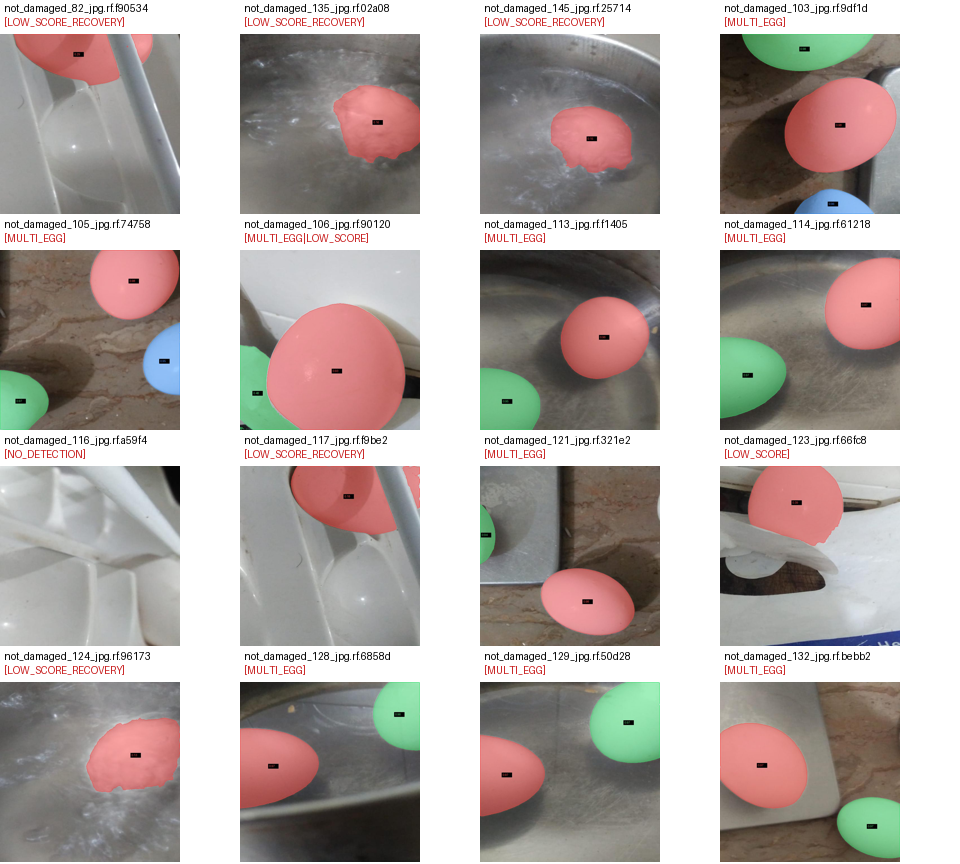

# Egg Segmentation and Tracking — CV Internship Assignment Report
Dhruv (dptel22) · 1 November 2026 · Nosh-Robotics repository

## 1  Overview
This report documents four tasks on one dataset of 160 egg photographs. In Task 1 I ran the pretrained SAM 3 model on all 160 images to produce pseudo ground-truth masks. In Task 2 I built a classical image-processing segmenter and tuned it against those masks on a leakage-controlled dev split, freezing one configuration. In Task 3 I measured the frozen segmenter against the SAM masks on a held-out evaluation split. In Task 4 I reused the frozen segmenter, with video-specific overrides, to detect and track eggs individually in a 60-second cooking video.

Repository layout: Task_1.ipynb, Task_2.ipynb, Task_3.ipynb (Google Colab), egg_segmenter.py and task4_track.py (Task 4), the dataset under data/ (not committed), all results under output/, and the AI log at docs/AI_USAGE_LOG.md. Tasks 1–3 are Colab notebooks that unzip the dataset and the previous task's archive; exact setup and run commands are in README.md. Task 4 runs locally: py -3.12 task4_track.py --video video/Raw-and-Boiled-SnapYT.App.mp4 --config output/final_config.json --out output/task4 (a --preview flag renders 12 sample frames first).

Output video (public Google Drive folder): https://drive.google.com/drive/folders/1hkSgiil8bvMaxICCLFTDfrn3z1tSsyrn?usp=sharing — the result file inside the folder is tracked_eggs.mp4 (H.264, 1280×720, 24 fps).

## 2  Dataset and split
The dataset is the Roboflow export “egg.v3i.folder” (universe project fire-bf7qe/egg-vzhtr, CC BY 4.0, exported 2025-05-23): 160 photos, auto-oriented and resized to 640×640. Roboflow divides them into its own folders — train 112, valid 32, test 16 (70/20/10) — and renames files with augmentation suffixes (.rf.<hash>). Content varies widely: white through dark-brown eggs, hands holding eggs, patterned dishes, concrete, printed packaging, and eggs in boiling water. That variety is what breaks every fixed colour assumption in Task 2.

Task 2 does not use Roboflow's folders. They are 70/20/10, not the required 4:1, and nothing in them stops near-duplicate burst shots from landing in different folders. In this export no two of the 160 filenames share a base name before the .rf. suffix (I checked), so the leakage risk was same-scene captures under different names. I built my own split: perceptual hashes (pHash) group images within Hamming distance 10 of each other (or with identical base names), then sklearn's GroupShuffleSplit draws 20% for evaluation with seed 42, so a group never crosses the split. Result: dev 127 / eval 33 (3.85:1) from 156 groups (largest group 2); the closest dev-vs-eval pHash distance is 16. Dev draws 88/26/13 and eval 24/6/3 images from Roboflow's train/valid/test folders, so both sides see the same kinds of photos. A manual audit recorded 3 true duplicate pairs (78↔27 d=2, 51↔45 d=6, 60↔8 d=6) and 1 false merge (1↔7 d=10). I kept THR=10: a false merge only forces two unrelated images onto the same side of the split, while tightening the threshold would reshuffle the split and invalidate the already-logged trials.

## 3  Task 1 — SAM 3 pseudo ground truth
Decision. Run SAM 3 (facebookresearch/sam3, 3.45 GB checkpoint) on Google Colab (T4 GPU) with text prompt “egg” and confidence threshold 0.30. Why: my planning notes record that SAM 3 “can replace two models” — the earlier plan used GroundingDINO to feed prompts to SAM — and that it cannot run on my hardware, which made Colab the practical option. No reason is recorded for the prompt or the threshold.

What happened. The first pass produced at least one mask for 150 of 160 images, at 3.71 s/image. Detections pass a GPU mask-NMS (area window 0.002–0.98 of the image, suppression at IoU 0.70) and are painted in reverse confidence order so overlapping instances keep separate label ids — that label structure is what later lets Task 3 count touching eggs separately. The QA summary flagged 126 clean single-egg images, 22 multi-egg, 7 low-score recoveries, 3 low-score, 1 very large mask (not_damaged_48, score 0.914, area above 0.90), and 3 with no detection.

Empty masks and the patch. Ten images first returned nothing. I re-ran exactly those with fallback prompts (“egg”, “boiled egg”, “brown egg”, “white egg”, “oval object”) at threshold 0.12, keeping only the best mask. Seven recovered, flagged LOW_SCORE_RECOVERY with scores 0.133–0.285 (e.g. not_damaged_124 recovered at 0.133 via “white egg”). Three stayed empty: not_damaged_42 and _77 (dev) and not_damaged_116 (evaluation) — difficult scenes such as eggs in boiling water. The pre-patch baseline (dev mIoU 0.5334) survives only in the mid-run notes; the logged trials in Section 4 were computed after the patch, and both empty dev keys sit inside those dev averages at IoU 0.

*Figure 1 — Task 1 overlays. Left: a clean detection (not_damaged_101, score 0.969). Right: a LOW_SCORE_RECOVERY case (not_damaged_124, score 0.133) that exists only because of the fallback-prompt patch.*

QA and limits. I reviewed the overlays on a contact sheet that lists flagged images first (Appendix, Figure A1). Two train images (135, 145) sit in Roboflow's “Unlabeled” class folder; both are near-miss scenes the recovery pass caught at 0.162 and 0.146. The masks are pseudo ground truth: seven of the keys exist only via the 0.12-threshold pass, and three images have no key at all — every downstream metric measures agreement with SAM 3, not with truth.

## 4  Task 2 — classical segmenter and experiment log
The dev/eval split and its leakage control are Section 2; all trials below score on the 127-image dev split against the patched Task 1 masks.

### 4.1  The frozen algorithm in plain English
1. Gaussian-blur the image (5×5 kernel). 2. Convert to grayscale and threshold with Otsu's method — bright pixels become candidate foreground. 3. Fill holes in the candidate mask. 4. Find connected components. 5. Keep the single largest component. 6. Copy it to the output mask. No morphology, skin filter, colour rule, or boundary refinement is active in the frozen configuration.

| parameter | value | role in the frozen configuration |
|---|---|---|
| denoise | gauss | active — 5×5 Gaussian blur |
| mode | otsu_gray | active — grayscale Otsu threshold |
| select | largest | active — keep the largest component; ignores the area/solidity filters below |
| min_area / max_area | 0.005 / 0.98 | inert (only used by select=score/shape) |
| min_solid | 0.9 | inert (only used by select=shape) |
| s_max / v_min | 65 / 150 | inert (HSV modes only) |
| l_min / ab_tol | 140 / 22 | inert (hsv_lab mode only) |
| skin | false | off |
| morph, k_open, k_close | false, 5, 15 | off |
| refine | null | off (no hull / ellipse / GrabCut polish) |
| gc_margin / gc_iters | 0.08 / 4 | inert (mode=grabcut only) |

*Table 1 — final_config.json, the frozen Task 2 configuration.*

### 4.2  Experiment log (every trial, failures included)
| trial | what changed | why I tried it (from the log) | parameters | dev mIoU / Dice | kept or discarded — reason |
|---|---|---|---|---|---|
| T0 | nothing — baseline | baseline: gray + Gaussian + Otsu + largest blob (zero tuning) | defaults (Table 1) | 0.5558 / 0.665 | KEPT — frozen as final_config.json |
| T1 | HSV white-egg rule | white egg = high V, LOW saturation; should reject warm skin and dark background | mode=hsv — s_max 65, v_min 150 | 0.5588 / 0.6698 | discarded — mIoU +0.003 is a tie at 127 images; median 0.5661 vs 0.5809 and recall 0.7207 vs 0.735 are lower; the colour rule is blind to the dark brown/grey eggs — 24, 28 enter its worst-5. Reason reconstructed from the logged numbers. |
| T2 | geometric blob score | pick the most egg-like blob — convex, ellipse-like, central, big; wrong blob won in 108, 28, 39 | select=score — min_solid 0.9, area 0.005–0.98 | 0.5462 / 0.6517 | discarded — worse than baseline; the score sometimes preferred a wrong-but-rounder blob and did not fix the threshold-level failures — 10, 28, 39 stayed worst-5. |
| T3 | GrabCut, no colour rule | no colour rule: eggs here are white, brown, on any background; assume big and central | mode=grabcut — gc_margin 0.08, gc_iters 4 | 0.5402 / 0.6469 | discarded — worse score at 8670 ms/image, ≈114× the baseline. Row missing from experiments.csv; value read from the notebook cell output. |

*Table 2 — all trials on the 127-image dev split. Sources: experiments.csv for T0–T2 and Task_2.ipynb cell output for T3.*

### 4.3  How the trials led to the frozen algorithm
T0 set the zero-tuning bar at dev mIoU 0.5558. T1 tested the “eggs are white and bright” hypothesis: mIoU moved +0.003 — a tie — while median and recall dropped, and dark eggs (24) and grey-on-concrete (28) entered its worst-5; a fixed colour prior fails exactly where this dataset is diverse. T2 replaced “largest blob” with an egg-likeness score (convexity × ellipse fit × centrality × size): mIoU fell to 0.5462, and the underlying bright-region errors stayed. T3 removed colour assumptions entirely with GrabCut seeded from a centre rectangle: 0.5402 at 8670 ms/image. Every alternative was worse or tied, so I froze T0 unchanged. The experiment log does not record a reason at the time of freezing; this rationale is reconstructed from the logged numbers. The hypothesis that failed hardest was T1's — see Figure A3 in the Appendix for what “wrong blob wins” looks like on 108 and 39.

Honesty notes on the log itself: experiments.csv has only T0–T2 (T3 ran afterwards and its row was never appended before the archive was downloaded); its per-row decision column was left blank — the decisions live here and in decisions.md; and GrabCut was not RNG-seeded during Task 2, so T3's exact number is not reproducible — Task 3 onward seeds the RNG.

## 5  Task 3 — evaluation of the frozen segmenter
Protocol. Task 1 masks are the answer key, the frozen segmenter is the prediction, and the split is the same split.json as Task 2. The eval side was scored exactly once, after the freeze — the scoring cell records: “Eval is scored here and nowhere else” — and all tuning used dev only. Three images with empty keys — 2 dev, 1 eval — stay in the CSVs but leave the averages, so dev n=125 and eval n=32.

| metric — mean / median | dev — n=125 | eval — n=32 |
|---|---|---|
| IoU | 0.565 / 0.589 | 0.615 / 0.677 |
| Dice | 0.676 / 0.741 | 0.729 / 0.807 |
| precision | 0.684 / 0.776 | 0.793 / 0.970 |
| recall | 0.747 / 0.825 | 0.746 / 0.797 |
| boundary F1 — 3 px | 0.230 / 0.160 | 0.240 / 0.186 |
| HD95 — px | 207.3 / 199.3 | 188.2 / 176.8 |
| instance P / R / F1 | 0.624 / 0.473 / 0.538 | 0.812 / 0.605 / 0.693 |
| mean |count error| | 0.32 | 0.344 |

*Table 3 — pixel, boundary and instance metrics; empty-key images excluded.*

Headline numbers. Eval mean IoU is 0.615 with a 95% bootstrap interval of 0.531–0.692 — 1000 resamples; median 0.677; Dice 0.729; runtime 30 ms/image. IoU of at least 0.85 on 3 of 32 images and below 0.1 on 1. The dev–eval gap is −0.051: the eval side came out easier, not harder — 27 of 127 dev images have multi-egg keys against 8 of 33 eval, and 15 dev images score IoU below 0.1 against 2 on eval, so dev simply contains more of the hard scenes. Instance recall of 0.605 is capped by design: the frozen segmenter outputs exactly one blob — n_pred = 1 on every usable eval image — while 8 eval keys contain 2–3 eggs; the key's touching eggs stay separate because it uses SAM's label ids. Boundary quality is the weakest axis: boundary F1 is 0.240 and HD95 is 188 px — even where regions roughly coincide, the outline is off by tens of pixels.

*Figure 2 — quantitative overview of eval. Note the bimodal IoU histogram — a mean of 0.615 hides a failed tail — and panel 5: failures cluster left of the red line, where the egg is darker than its background.*

*Figure 3 — the 8 worst eval images: photo, SAM answer key, frozen prediction, error overlay — green = both, red = extra, blue = missed.*

*Figure 4 — automatic error categories over the 32 usable eval images.*

Failure analysis. The automatic taxonomy splits eval into mixed 14, under-segmented 9, over-segmented 5, good 3, wrong-object 1. Reading the worst gallery — causes proposed, Dhruv to confirm: the one wrong-object failure (117, IoU 0.05) is an egg darker than its background, where a global Otsu threshold inverts; the over-segmented group (51, 45, 22, 5, 62 — IoU 0.16–0.52) is bright cluttered scenes where the largest bright blob swallows more than the egg; under-segmentation (147, 103, 35, 73, 114 — IoU 0.36–0.56) concentrates on multi-egg keys merged into one component and on partially visible eggs. What I would try next, limited to what this data supports: (1) local or adaptive thresholding instead of one global Otsu — the failure–brightness correlation in Figure 2 panel 5 directly motivates it; (2) the existing select="shape" multi-blob mode to lift instance recall on the 8 multi-egg eval keys, tuned on dev only; (3) the existing GrabCut trimap refinement targeted at boundary F1 and HD95, again on dev only. Limits: the key is SAM, not human annotation, and n=32 keeps the interval wide.

## 6  Task 4 — tracking eggs in the video
Method. The frozen segmenter is extracted verbatim into egg_segmenter.py with one addition, cv2.setRNGSeed(0), so GrabCut is deterministic. The frozen configuration itself is unusable on video: run unchanged on full frames it masks the chef's shirt, hands and on-screen graphics instead of eggs — Figure 5, top. The video configuration therefore overrides it: HSV foreground (V at least 170, S at most 70) for white eggs, morphological close, select="shape" with min_solid = 0.0 so merged or oddly shaped blobs survive until the detector can cut them apart, and a table ROI that crops the top 25% of every frame. These overrides equal the recorded starting guesses; they were judged by eye on preview frames of this same video, and no held-out video exists. Detection then gates blobs by area — 1–15% of the frame — and ellipse fit of at least 0.85, with a morphological-opening fallback — kernels 11/21/31 — that severs thin text/arrow attachments. Tracking is a constant-velocity 2D Kalman filter per egg with Hungarian assignment under a 0.12×width — 154 px — gate; an id is assigned after 3 consecutive hits (MIN_HITS) and dies after 3.0 s without a match (MAX_MISSED). A camera cut — 32-bin grayscale histogram correlation below 0.6 on 160×90 thumbnails — resets all tracks, and ids are never reused.

| segmenter overrides | frozen | video |
|---|---|---|
| mode | otsu_gray | hsv |
| s_max / v_min | 65 / 150 | 70 / 170 |
| morph | false | true — close 15 |
| select | largest | shape |
| min_area / max_area | 0.005 / 0.98 | 0.01 / 0.5 |
| min_solid | 0.9 | 0.0 |

*Table 4 — Task 4 segmenter changes vs the frozen config — denoise=gauss, skin=off, refine=none unchanged.*

| video-only constant | value |
|---|---|
| ROI_TOP — top of frame ignored | 0.25 |
| AREA_RANGE — fraction of frame | 0.01 – 0.15 |
| MIN_ELLIPSE_FIT | 0.85 |
| OPENING_SIZES — attachment cutting | 11, 21, 31 |
| MAX_DIST_FRACTION — match gate | 0.12 × width = 154 px |
| MIN_HITS / MAX_MISSED_SECONDS | 3 / 3.0 s — 72 frames |
| CUT_THRESHOLD — histogram correlation | 0.6 |
| TRAIL_LENGTH | 40 |

*Table 5 — video-only constants, from settings_used.json.*

*Figure 5 — top: the frozen config on full frames masks shirt, hands and graphics instead of eggs (preview_before.png); bottom: the video config with table ROI and ellipse gating (preview_after.png). Both from output/task4/.*

Results. On the 1440-frame, 24 fps video the run detected 14 camera-cut frames in two clusters (210–221 and 1001–1010) and produced 13 track ids. The longest tracks are id 1 (9.29–36.92 s, 563 matched frames), id 2 (9.29–30.42 s, 507), id 8 (31.21–41.67 s, 252) and id 10 (33.79–41.58 s, 188); ids 3, 4, 6 and 7 lived under 2 s. Detection averages 1.32 per frame with max 5; 658 frames have zero detections — the title intro, 0–9.3 s, and outro, 41.7–60 s. One suspect id switch was flagged: id 2 lost at 33.46 s, id 10 born at 33.79 s, 189 px apart — worth an eyeball check in the video. [CONFIRM] Which ids are real eggs versus shirt or on-screen graphics requires my visual pass over the output video; this report does not assert per-id identities.

Observed limitation — shirt false positives. The chef wears a red-white checkered shirt. Its white checks pass the HSV rule, morphological close merges them into large blobs, min_solid = 0.0 keeps them, and the opening fallback can carve shirt regions into ellipse-shaped pieces that pass the 0.85 fit gate. The result is false contours and short-lived tracks on the shirt, visible in the output video and in Figure 5. min_solid = 0.0 was deliberate — without it, merged egg pairs would be dropped before the cutting step could separate them — but the shirt detections are an observed limitation of this run, not an accepted trade-off. Known tracker limits, documented in TASK4_EXPLAINED.md: histogram cut detection can miss cuts between similar camera angles, and ids are per shot — identical-looking eggs cannot be re-identified across a cut.

*Figure 6 — X-position over time per track id. Two long tracks — ids 1 and 2 — hold near-constant X positions for most of the scene; all tracks end at the second cut cluster, about 42 s, where the outro begins.*

## 7  Limitations
- Task 1 masks are pseudo ground truth: every metric in Tasks 2–4 measures agreement with SAM 3, not with truth. Seven keys exist only via the 0.12-threshold recovery pass — scores 0.133–0.285 — and three images have no key at all.
- Small eval set: 32 scored images; the 95% interval on mean IoU is ±0.08, and instance recall rests on 43 key eggs.
- In the frozen configuration only denoise, mode and select are active; min_area, max_area, min_solid and every colour/GrabCut parameter are inert — Table 1.
- Dev trial averages include the 2 empty-key dev images at IoU 0; Task 3 excludes empty keys. Both protocols are stated where used.
- T3's number is absent from experiments.csv — read from the notebook output — and Task 2-era GrabCut was unseeded, so T3 is not exactly reproducible.
- Task 4's video thresholds were judged by eye on frames of the same video; there was no held-out video to validate them, and the shirt false positives in Figure 5 show the cost.
- The mid-run notes — docs/TASK_2_EXPERIMENT_LOG.md and parts of docs/AI_USAGE_LOG.md — contain superseded numbers, e.g. a pre-patch baseline of 0.5334 and “T2 KEPT”. This report follows the machine-readable outputs throughout.

## 8  AI tool disclosure
AI coding assistants were used throughout, and every use is logged in docs/AI_USAGE_LOG.md. Setup and debugging in Task 1: the SAM 3 editable-install BPE path fix, gated-repo access on Hugging Face, and the bfloat16 autocast / NumPy cast fixes. Pipeline review: prefetching via DataLoader, thread-pool writes, vectorized mask NMS, and resume-safe CSV handling. Task 2: designing the pHash group split, diagnosing empty pseudo-ground-truth masks, and formulating the egg_score and GrabCut modules. Task 4: AI authored egg_segmenter.py — the frozen segmenter plus RNG seeding — and task4_track.py, covering Kalman tracking, Hungarian matching, the table ROI, the opening fallback, histogram cut detection, and the H.264 transcode. I ran all experiments, audited the duplicate clusters and flagged masks by eye, and made the keep/discard and freeze decisions; the freeze rationale is reconstructed — Section 4.3. [CONFIRM] whether the Antigravity tool was also used. [CONFIRM] that I have read and can explain each AI-generated file.

---

## Appendix

*Figure A1 — Task 1 QA contact sheet, extracted from the saved Task_1.ipynb cell output; the notebook displayed it but never wrote it to disk. Flagged images come first: recoveries, multi-egg, no-detection, very-large-mask.*

*Figure A2 — detections (grey dots) vs tracked eggs per frame; red dashes mark the 14 detected camera cuts. Zero counts are the intro and outro; the detection count peaks at 5 mid-scene.*

*Figure A3 — why “largest bright blob” fails: not_damaged_108 (patterned dish) and not_damaged_39 (printed packaging), both named in the trial log's worst lists. Red = SAM key, green = frozen prediction, yellow = overlap.*
